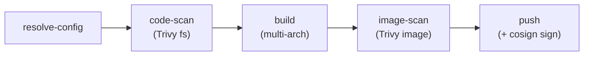

# Code Build: getting started

This page explains what the build system is and how a single build runs from
end to end. If you want to put a service on it, go to
[onboarding-a-service.md](onboarding-a-service.md); to run and consume builds,
see [access-and-use.md](access-and-use.md).

## The idea

There is **one** build engine for all eGov service repos. It lives in this repo
at [`.github/workflows/reusable-build.yaml`](../../.github/workflows/reusable-build.yaml)
and is a GitHub Actions reusable workflow (`on: workflow_call`). Each service
repo keeps a thin **caller** workflow ("Build - Code") that calls this engine
once per service and passes the service list plus registry credentials.

Because the logic is centralized:

- a fix to the build/scan/sign flow lands in one place and reaches every repo;
- a service repo only declares *what* to build (its `build/build-config.yml`),
  not *how*;
- callers pin the engine by a moving tag `@reusable-build-v1`, so they pick up
  engine changes automatically (see [maintenance.md](maintenance.md)).

## The pipeline

For a scanned branch the engine runs:

1. **resolve-config** - reads `build/build-config.yml`, finds the work-dir and
   Dockerfile for the requested `service` and any `<service>-db` entry, computes
   the image tag as `<branch>-<short-sha>`, and decides the scan policy.
2. **code-scan** - Trivy filesystem scan of the service source. A CRITICAL
   finding fails the job, so nothing is built.
3. **build** - builds the app image (and the `-db` image when present) locally
   on `linux/amd64` so the exact artifact can be scanned.
4. **image-scan** - Trivy scans the built image(s); app and db findings are
   combined into one report under the service. A CRITICAL fails the job before
   anything is pushed.
5. **push** - builds and pushes multi-arch (`linux/amd64,linux/arm64`) to
   `docker.io/egovio/<service>` (and `docker.io/egovio/<service>-db`), reusing
   the layer cache so the pushed amd64 is the scanned layers.
6. **cosign sign** - signs the pushed digest(s) keyless (GitHub OIDC -> Fulcio
   -> Rekor); no private key to manage.

The order is code-scan -> build -> scan-the-built-image -> push, so the image
that is scanned is exactly the image that is pushed, and a CRITICAL at either
gate blocks the push.

Full step-by-step reference: [../workflows/build.md](<../1. Workflows/build.md>).

## Branches: what gets scanned

Scanning and gating run **only for the branches you list** in the
`TRIVY_SCAN_BRANCHES` repo variable (passed to the engine as `scan_branches`,
for example `master` and `develop`). Any other branch is built and pushed
**unscanned**, so feature-branch builds are fast and never blocked. When
`TRIVY_SCAN_BRANCHES` is empty the engine falls back to the default branch only.

## The image tag

Every build produces the tag `<branch>-<short-sha>` (for example
`master-1a2b3c4`). This is the single identifier the rest of the pipeline keys
off: Helm charts reference it, and Kargo discovers it as Freight. See
[Kargo Promotions](<../4. Kargo Promotions/>) for how a new tag is picked up.

## Auth and credentials

Two separate credentials are in play:

- **Registry push** - the caller passes `DOCKER_USERNAME` (repo variable) and
  `DOCKER_ACCESS_TOKEN` (repo secret). These log the engine in to Docker Hub.
- **GitHub App** - used by the *setup* side (not the build) to scaffold the
  caller and the dashboard and to push directly to the default branch. The App
  has Contents + Workflows + Pages write and must be on the default-branch
  ruleset bypass list. Its `APP_CLIENT_ID` + `APP_PRIVATE_KEY` are minted into a
  short-lived token at run time. Details: [../workflows/setup.md](<../1. Workflows/setup.md>).

## Outputs

- Images at `docker.io/egovio/<service>` and `docker.io/egovio/<service>-db`.
- A Trivy security dashboard on the repo's GitHub Pages at
  `https://<owner>.github.io/<repo>/security/trivy/`.
- cosign signatures recorded in the public Rekor transparency log.
