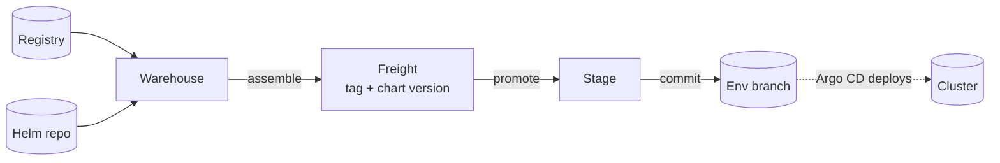

# Kargo Promotions - Getting Started

[Kargo Promotions](README.md) - Getting Started

## What Kargo does

A release of a service is two artifacts that belong together:

| Artifact | Published to | Example |
|---|---|---|
| Container image (and optional migration image `<service>-db`) | Container registry | `docker.io/egovio/<service>:master-1a2b3c4` |
| Packaged Helm chart | `https://helm.digit.org` | chart `<service>`, version `3.0.1` |

Kargo pins one image tag and one chart version together as **Freight** and moves it into an environment. A promotion writes those two versions into the environment's env file and pushes a commit; Argo CD picks the commit up and deploys it (see [Argo CD](<../5. Argo CD/>)).

## Concepts in one minute

- **Project** is a module (for example `crest-lts`, `studio-lts`). It is also a namespace on the Kargo cluster. Its config file lists the services, the stages, and the teams.
- **Warehouse** watches one service: the image tags in the registry, and the chart versions in the Helm repo. It offers candidates; it does not pick for you.
- **Freight** is what you assemble and what you promote. It is immutable: one image tag plus one chart version, for one service.
- **Stage** is one environment for one service. Promoting Freight to a stage runs the promotion steps: write the versions into that stage's env file on that stage's branch, commit, push.

## Single stage vs a promotion chain

A project's stages are declared in its config. Two shapes are common:

- **Single standalone stage** - one environment, no chain. Example: the `digit-lts` environment, where `crest-lts` and `studio-lts` each promote straight from the Warehouse into one stage named `digit-lts`. Here `masterOnlyStages: []` because there is no production-like tail to guard.
- **Linear chain** - `dev <- Warehouse`, `qa <- dev`, `uat <- qa`. Each stage's `from:` names the stage upstream of it, so only Freight that has already run upstream can move on. `masterOnlyStages` (default `[uat]`) then rejects any non-`master-*` image before the production-like stage.

Promotion is always a deliberate human action: `autoPromotion` stays `false`.

## Find the control plane

Each environment runs one Kargo control plane with a web UI, for example `https://kargo-latest.digit.org` for the `digit-lts` environment. You log in there to assemble Freight and promote. Access is covered in [access-and-use.md](access-and-use.md).

## Where things live in git

| Thing | Path |
|---|---|
| Pipeline chart (renders all Kargo objects) | `deploy-as-code/helm/charts/kargo/` |
| One project config per module | `deploy-as-code/helm/charts/kargo/config/projects/<project>.yaml` |
| Control-plane config (host, SSO, Argo CD URL) | `deploy-as-code/helm/charts/kargo/config/control-plane.yaml` |
| ApplicationSet that turns each config into a pipeline | `deploy-as-code/helm/charts/argo-cd/kargo/kargo-app-set-pipelines.yaml` |
| Env file a promotion writes into | `deploy-as-code/helm/environments/<module>-<env>.yaml` |

## Next

- Adding a service or project: [onboarding-a-service.md](onboarding-a-service.md)
- Daily use (log in, assemble Freight, promote): [access-and-use.md](access-and-use.md)
