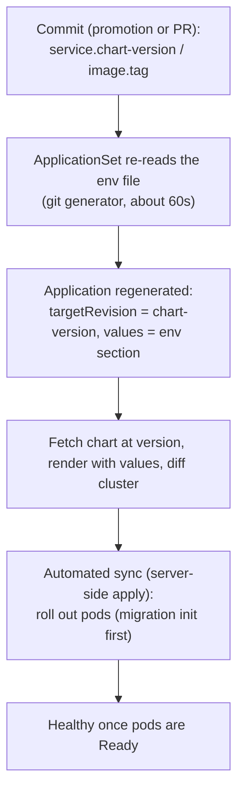

# Argo CD - Getting Started

<sub>[Argo CD](README.md) - Getting Started</sub>

## Bootstrap

Each cluster runs **one Application applied by hand**: the bootstrap, or app-of-apps. It syncs the environment's Argo CD directory recursively (for example `deploy-as-code/helm/charts/argo-cd/`), so **adding a manifest file under it creates the object**. Everything else - AppProjects, ApplicationSets, the config Applications, even Argo CD's own self-management - comes from git through this one Application.

| Setting | Consequence |
|---|---|
| `selfHeal: true` | Edits made directly on the cluster to these objects are reverted |
| `prune: false` | Deleting a file does **not** delete the object; retired objects are removed by hand (see [maintenance.md](maintenance.md#retire-an-application)) |

## AppProject: the security boundary

One AppProject per module limits what its Applications may touch:

| Field | Rule |
|---|---|
| `sourceRepos` | Every repository its Applications use: the git repo **and** `https://helm.digit.org` |
| `destinations` | Exactly the module's namespaces. Anything rendered elsewhere fails the sync |
| `clusterResourceWhitelist` | Empty, unless a chart genuinely needs a cluster-scoped kind |

## From env file to running Deployment



1. A commit changes `<service>.chart-version` and/or `<service>.image.tag`.
2. The ApplicationSet re-reads the env file (git generator requeues about every 60s).
3. The Application is regenerated: `source.chart`, `source.targetRevision: <chart-version>`, and the env-file values for the service.
4. Argo CD renders the chart at that version and diffs against the cluster.
5. Automated sync applies the difference; the pod template changes, so Kubernetes rolls out new pods (the migration init container runs first).
6. Health goes Progressing, then Healthy when the new pods are Ready.

Expect the sync to start about one minute after the commit.

**Two details decide what actually runs:**

- **Chart versions are exact.** A version removed from the Helm repo can no longer be rendered (`ComparisonError`), and Argo CD keeps the last applied state.
- **Image-tag mode.** Some library charts use the chart `appVersion` as the image tag unless told otherwise. Where Kargo promotes image tags, set the switch in the env file so the pinned tag is honoured:

  ```yaml
  global:
    mode: dev     # honour <service>.image.tag
  ```

## Where things live in git

| Thing | Path (example) |
|---|---|
| Bootstrap / app-of-apps | applied by hand per cluster |
| Argo CD manifests the bootstrap syncs | `deploy-as-code/helm/charts/argo-cd/` |
| Env file per module | `deploy-as-code/helm/environments/<module>-<env>.yaml` |
| Encrypted secrets twin | `deploy-as-code/helm/environments/<module>-<env>-secrets.yaml` |
| SOPS rules | `deploy-as-code/helm/.sops.yaml` |

## The UI

Argo CD serves a web UI, typically behind the environment's gateway, for example `https://test-lts.digit.org/argocd`. Reaching it and reading an Application's state is in [access-and-use.md](access-and-use.md).

## Next

- Adding an application or module: [onboarding-a-service.md](onboarding-a-service.md)
- Reaching the UI and checking a deployment: [access-and-use.md](access-and-use.md)
