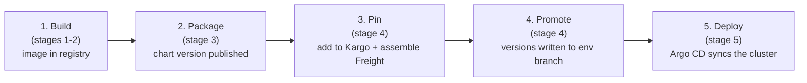

# Onboarding a new service

<sub>[Deployment Documentation](README.md) - Onboarding a new service</sub>

This is the single, ordered path that takes a service from source code to running in an environment, across all five stages: **build the image -> publish the chart -> pin them as a release -> deploy**. Each step links to the stage page that explains it in full; this page is the spine that keeps the order and the handoffs straight.

The same process applies to **every** published `digit3` module - `core`, `crest`, `studio`, `health`, `cms`, and the `backbone` infrastructure. Replace every `<placeholder>` (see the [placeholder table](README.md#placeholders)).



## First, the one rule that prevents most onboarding failures: the naming contract

One service name **must be identical** everywhere it appears. The stages find each other by this name; a mismatch does not raise an error, it just silently does nothing (a Warehouse finds no images, or a config key is ignored).

| Stage | Where the name appears | Example |
|---|---|---|
| 2 - Code Build | `build-config.yml` `image-name` -> pushes `egovio/<name>` | `collection-service` |
| 3 - Helm | chart directory and `Chart.yaml` `name` (strip any `digit-` prefix) | `collection-service` |
| 4 - Kargo | service `name` (and `chart`) in the project config | `collection-service` |
| 5 - Argo CD | the env-file section named after the chart | `collection-service:` |
| 5 - Argo CD | the generated Application name, `<app-prefix><name>` | `egov-collection-service` |

If the service runs database migrations, the **same** rule applies to its migration image at `<name>-db` (`egovio/collection-service-db`).

## Second, know how your environment deploys

Two models exist; pick the one your environment uses before you start, because steps 3-4 differ.

| Model | How a release is set | Use when |
|---|---|---|
| **Kargo-managed** | Kargo assembles Freight and a promotion writes the versions into the env file | The environment runs Kargo (for example **digit-lts**). This is the default path below |
| **Argo CD only** | An engineer sets `chart-version` and `image.tag` in the env file by pull request | No Kargo on the environment |

The steps below follow the **Kargo-managed** path and note the Argo-CD-only difference where it matters.

## The steps

### Step 1 - Build the image (stages 1-2)

Get the service building a signed, scanned image in the registry.

1. If the repo is **not yet on Code Build**, do the one-time repo onboarding (install the build GitHub App, add the secrets/variables, add the Setup caller, run **Build - Setup**). Full runbook: [Workflows - onboarding](<1. Workflows/onboarding.md>).
2. Add the service to `build/build-config.yml` with the `image-name` from the naming contract. Add a second entry ending in `-db` only if the service has database migrations. Detail: [Code Build - onboarding](<2. Code Build/onboarding-a-service.md>).
3. Run **Build - Setup** (`mode: sync`) to refresh the dropdowns, then run **Build - Code** on your branch.

**Done when:** `docker.io/egovio/<name>:<branch>-<sha>` exists in the registry (plus `<name>-db` if applicable), and the Trivy gate passed on a scanned branch. See [Code Build - access and use](<2. Code Build/access-and-use.md>).

### Step 2 - Publish the chart (stage 3)

Package the service as a versioned chart so a deploy references a version, not a branch.

1. Scaffold the chart under `charts/digit3/<module>/<name>/`, following the [digit3 chart conventions](<3. Helm Packaging & Releasing/onboarding-a-service.md>): chart `name` = the naming-contract name, `appVersion` = the real build tag, `common` dependency pinned to a published version, ingress/context-path, `appType`.
2. If the service needs a new shared config key, internal URL, or Secret, add it to `cluster-configs` (per-environment values go in the env file, not here).
3. Validate locally (`helm dependency build` + `helm lint` + `helm template`), open a PR (one project + one module per PR), tick one release type on the auto-injected form, and merge. CI versions and publishes it.

**Done when:** the chart appears at `helm.digit.org/digit3/<module>/<name>` (`helm search repo` lists it). See [Helm - access and use](<3. Helm Packaging & Releasing/access-and-use.md>).

### Step 3 - Pin the image and chart together (stage 4)

Make Kargo aware of the service so it can bind an image tag and a chart version into one release (Freight).

1. Add the service to the Kargo project config `deploy-as-code/helm/charts/kargo/config/projects/<project>.yaml` under `services:` (name, `chart`, `dbMigration: true` if it has a `-db` image, any per-service overrides). Detail: [Kargo - onboarding](<4. Kargo Promotions/onboarding-a-service.md>).
2. Add the service's **values** (replicas, ingress, env overrides) to each stage's env file, in a section named after the chart. Do **not** add `chart-version` or image tags - Kargo owns those keys.
3. If the service deploys to a new namespace, add it to the AppProject `destinations` **and** `argocd.namespaces` in the same PR.
4. Raise one PR and merge.

**Done when:** the pipeline Application `kargo-<project>` is Synced, and the service's Warehouse is Ready and lists image tags and chart versions. See [Argo CD - onboarding](<5. Argo CD/onboarding-a-service.md>) for how Applications are generated.

> **Argo CD only:** there is no Kargo step. Instead, add the service section to the env file **with** `chart-version`, `image.tag` (and the migration tag), then add the service to the module ApplicationSet (or rely on its selector). Skip to Step 5.

### Step 4 - Assemble Freight and promote (stage 4)

1. In the Kargo UI, open the service's Warehouse, pick **one image tag** and **one chart version**, and create the Freight.
2. Promote the Freight to the target stage. Kargo writes `<name>.chart-version`, `<name>.image.tag` (and the migration tag) into the env file and pushes the commit.

**Done when:** the promotion commit is on the environment branch. Full detail and the roles that may promote: [Kargo - access and use](<4. Kargo Promotions/access-and-use.md>).

### Step 5 - Confirm the deploy (stage 5)

Argo CD reads the environment branch and makes the cluster match it.

1. Within about a minute of the commit, the owning ApplicationSet re-reads the env file and (re)generates the Application.
2. Argo CD renders the chart at the pinned version and rolls out the pods (the migration init container runs first).

**Done when:** the Application `<app-prefix><name>` reaches **Synced** and **Healthy**. See [Argo CD - access and use](<5. Argo CD/access-and-use.md>).

## If the service has a database migration

One decision cascades through the whole path - handle it at each stage, not just once:

| Stage | What to do |
|---|---|
| 2 - Code Build | Add the `<name>-db` entry in `build-config.yml` so the migration image builds at the same tag |
| 3 - Helm | The chart runs the `<name>-db` image as a migration init container before the app |
| 4 - Kargo | Set `dbMigration: true` so the Freight pins the `-db` image tag too |
| 5 - Argo CD | The migration init runs first on every rollout; a failed migration blocks the pod |

The app image and its `-db` image are always a matched pair at the same tag - they are built, promoted, and deployed together.

## Checklist

```
[ ] 1. build-config.yml entry added (+ -db entry if migrations)   -> image in egovio/<name>
[ ] 2. chart published to helm.digit.org/digit3/<module>/<name>
[ ] 3. service added to the Kargo project config + values in the env file
[ ]    (new namespace? added to AppProject destinations AND argocd.namespaces)
[ ] 4. Freight assembled and promoted to the stage
[ ] 5. Application <app-prefix><name> is Synced + Healthy
```

## When a seam breaks

Most onboarding problems are at the handoffs, not inside a stage:

| Symptom | Likely seam | Where to look |
|---|---|---|
| Warehouse Not Ready, "No references discovered" | The name differs between Code Build / Helm / Kargo, or the chart is not published, or the tag filter matches nothing | [Kargo - maintenance](<4. Kargo Promotions/maintenance.md#troubleshooting>) |
| Promotion succeeded but nothing deployed | No Application for the service, or the commit did not reach the branch | [Argo CD - maintenance](<5. Argo CD/maintenance.md>) |
| Pod `CreateContainerConfigError` | The chart references a `cluster-configs` key that the env file / ConfigMap does not have yet | [Argo CD - onboarding](<5. Argo CD/onboarding-a-service.md>) (render and diff the keys first) |
| Application `ComparisonError` | The pinned chart version was unpublished or never existed | [Helm - maintenance](<3. Helm Packaging & Releasing/maintenance.md>) |
| Image runs the wrong tag | `global.mode` is `prod` (uses `appVersion`); set `global.mode: dev` so the pinned `image.tag` is honoured | [Argo CD - getting started](<5. Argo CD/getting-started.md>) |
