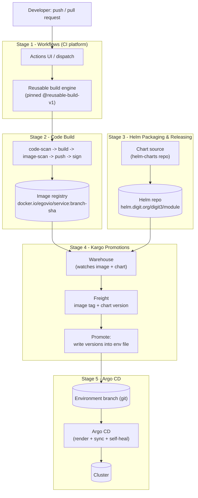
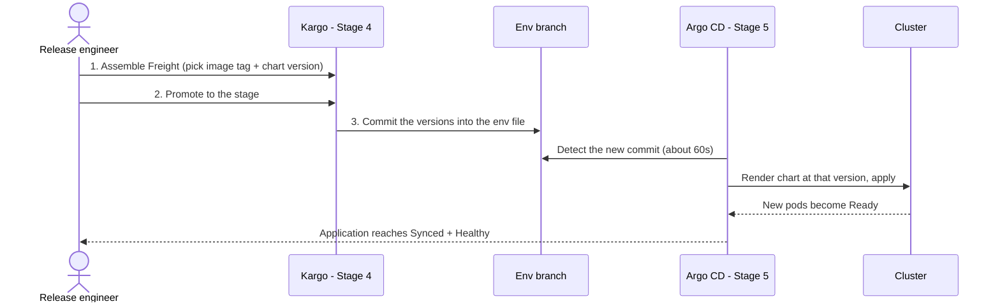
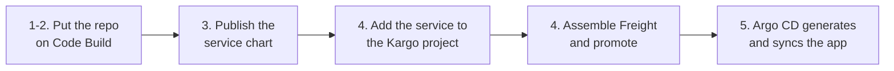

# Deployment Documentation

How a service travels from source code to running in an environment, and how to operate it once it is there. The journey is five stages. Each stage is its own directory, and the first four stages each explain themselves the same four ways: **getting started**, **onboarding a service**, **access and use**, and **maintenance**.

## The stages

| # | Stage | What it does |
|---|---|---|
| 1 | [Workflows](<1. Workflows/README.md>) | The central CI platform: a reusable GitHub Actions engine, the self-service dispatcher UI, and the auth behind them |
| 2 | [Code Build](<2. Code Build/README.md>) | Builds, scans, signs, and pushes each service's container image using that platform |
| 3 | [Helm Packaging & Releasing](<3. Helm Packaging & Releasing/README.md>) | Packages charts and publishes them, versioned, to `https://helm.digit.org` |
| 4 | [Kargo Promotions](<4. Kargo Promotions/README.md>) | Pins an image tag and a chart version together as Freight, and promotes it into an environment |
| 5 | [Argo CD](<5. Argo CD/README.md>) | Deploys whatever each environment's git branch describes, and keeps the cluster matching git |

Supporting material:

- [Templates](Templates/README.md) - ready-to-copy manifests and files for onboarding (Argo CD, Kargo, environments, access).

## Architecture

The two halves meet at the Warehouse: **Code Build** feeds it images and **Helm Packaging & Releasing** feeds it charts. **Kargo** binds one of each into Freight and writes the chosen versions onto an environment branch. **Argo CD** treats that branch as the source of truth and makes the cluster match it.

## Usage: releasing a service

Once a service is onboarded, a release is three actions and two automatic steps:

Start at [Kargo Promotions - access and use](<4. Kargo Promotions/access-and-use.md>), then confirm in [Argo CD - access and use](<5. Argo CD/access-and-use.md>).

## Usage: onboarding a new service

A new service is added once per stage, in order. The image and chart must exist before Kargo can promote them, and the Kargo entry must exist before Argo CD can generate its Application.

Each stage's **onboarding** page has the detail: [Code Build](<2. Code Build/onboarding-a-service.md>), [Helm Packaging & Releasing](<3. Helm Packaging & Releasing/onboarding-a-service.md>), [Kargo Promotions](<4. Kargo Promotions/onboarding-a-service.md>), [Argo CD](<5. Argo CD/onboarding-a-service.md>).

## Why it is built this way

- **Reproducible.** An environment runs exactly the chart version and image tag written in its git branch.
- **Auditable.** Every version change is a git commit, made by a promotion or a reviewed pull request.
- **Controlled.** Releases move through environments in a fixed order, and production-like stages accept only mainline builds.
- **Self-healing.** Drift on a cluster is corrected back to git automatically.

The model is used across environments. It can be adopted in full (Kargo + Argo CD) or with Argo CD alone (versions set by pull request instead of promotion).

## Who this is for

| Reader | Start with |
|---|---|
| Releasing or promoting an existing service | [Kargo Promotions - access and use](<4. Kargo Promotions/access-and-use.md>) |
| Adding a new service | Each stage's onboarding page, in order (see above) |
| Setting up a new environment or module | [Argo CD - onboarding](<5. Argo CD/onboarding-a-service.md>) and [Kargo - onboarding](<4. Kargo Promotions/onboarding-a-service.md>) |
| Triggering or debugging a build | [Workflows](<1. Workflows/README.md>) and [Code Build - access and use](<2. Code Build/access-and-use.md>) |
| Debugging a deployment | [Argo CD - maintenance](<5. Argo CD/maintenance.md>) and [Kargo - maintenance](<4. Kargo Promotions/maintenance.md>) |

## Prerequisites

Before services can be onboarded, an environment needs:

| Item | Requirement |
|---|---|
| Kubernetes cluster | One per environment. Kargo runs on one of them |
| Git repository | One protected branch per environment, pull-request reviews required |
| Helm repository | Packaged charts published to `https://helm.digit.org` (or its sub-path) |
| Container registry | Images `docker.io/<registry-org>/<service>` (and `<service>-db` for migrations) |
| Tag convention | Build tags that identify branch and commit (for example `master-<sha>`), per-architecture variants suffixed `-amd64` / `-arm64` |

## Placeholders

Templates and examples use `<placeholders>`. The common ones:

| Placeholder | Meaning | Example |
|---|---|---|
| `<org>/<repo>` | The git repository | `egovernments/DIGIT-DevOps` |
| `<env>` / `<env-branch>` | An environment and its branch | `digit-lts` |
| `<module>` / `<project>` | A module and its Kargo project | `crest-lts`, `studio-lts` |
| `<service>` | One deployable service | `public-service` |
| `<registry-org>` | The registry namespace | `egovio` |
| `<app-prefix>` | Prefix of an Argo CD Application name | `studio-` |

## Glossary

| Term | Definition |
|---|---|
| **AppProject** | Argo CD object limiting which repositories, namespaces and cluster-scoped kinds a group of Applications may use. One per module |
| **Application** | Argo CD object deploying one chart (one version, one set of values) into one namespace |
| **ApplicationSet** | Argo CD object generating Applications from a template and generators (lists, git files) |
| **Bootstrap Application** | The one Application applied by hand per cluster; it syncs all other Argo CD manifests for that environment |
| **Chart version** | The version of a packaged chart in the Helm repository, pinned per service per environment in the env file |
| **Config Application** | The Application rendering a module's ConfigMaps and Secrets into its namespaces |
| **Env file** | `<module>-<env>.yaml`: a module's values and pinned versions for one environment |
| **Environment branch** | The git branch describing one environment's cluster |
| **Freight** | Kargo's immutable release bundle: one image tag and one chart version for a service |
| **Project (Kargo)** | A module's pipelines, and a namespace on the Kargo cluster |
| **Promotion** | A Kargo action that writes a Freight's versions into an environment's env file and commits them |
| **Reusable workflow** | The central GitHub Actions build engine that service repos call by a pinned tag |
| **Stage** | One environment for one service in Kargo; holds the Freight that environment runs |
| **Warehouse** | Kargo object watching a service's image and chart, producing Freight |
