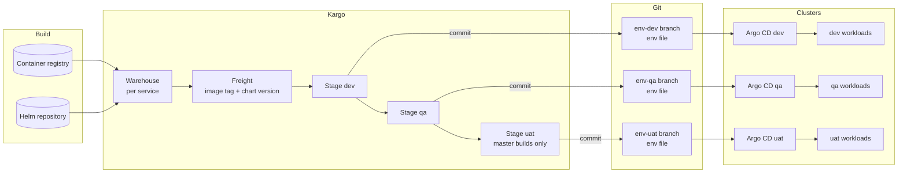
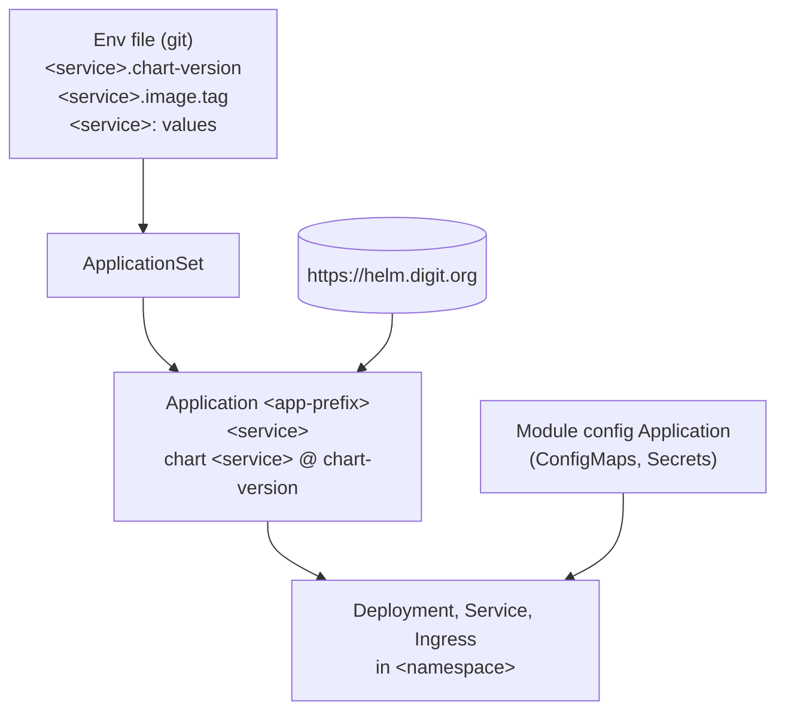

# Overview

**Deployment Guide** · Part 1 of 11 · [Contents](README.md) · Next: [Prerequisites and Installation](02-prerequisites-and-installation.md)

## Purpose

This approach gives every environment a single, reviewable description in git, and makes every release a recorded, deliberate step:

- **Reproducible.** An environment runs exactly the chart version and image tag written in its git branch.
- **Auditable.** Every version change is a git commit, made by a promotion or a reviewed pull request.
- **Controlled.** Releases move through environments in a fixed order, and production-like stages accept only mainline builds.
- **Self-healing.** Drift on a cluster is corrected back to git automatically.

## Building blocks

| Component | Role |
|---|---|
| **Container registry** | Holds application images (and, where used, a matching database-migration image `<service>-db`) |
| **Helm repository** (`https://helm.digit.org`) | Holds **packaged, versioned charts**. An environment pins an exact chart version. |
| **Git repository** (`<org>/<repo>`) | One branch per environment. Holds the env files (values and pinned versions) and the Argo CD manifests. |
| **Kargo** | Discovers new images and chart versions, bundles them as **Freight**, and **promotes** Freight by committing the versions to an environment's branch. |
| **Argo CD** | Watches each environment branch and **deploys** the pinned chart versions with their values; reverts drift. |
| **SOPS** | Encrypts secret values stored in git; Argo CD decrypts them at deploy time. |

## The release flow

1. A build publishes an **image** and the **chart** is published to the Helm repository.
2. Kargo's **Warehouse** for that service discovers both.
3. A release engineer assembles **Freight**: one image tag plus one chart version.
4. The Freight is **promoted** to dev. Kargo writes the chart version and image tag into the dev env file and pushes a commit.
5. Argo CD on the dev cluster sees the commit, renders the **chart at that version with those values**, and applies it.
6. The same Freight is later promoted to qa, then uat, each time by a person, in order.

Kargo never deploys to a cluster directly. **Git is the hand-off** between promotion and deployment.

## What a deployment is made of

- **One env file per module per environment** carries all of that module's values, and the pinned version of each service.
- **ApplicationSets** generate one Argo CD **Application** per service from that env file.
- A **module config Application** provides the shared ConfigMaps and Secrets the services read.
- An **AppProject** per module limits which repositories and namespaces its Applications may use.

## Adoption models

### Kargo + Argo CD

The full model. Kargo owns the version keys in the env files; Argo CD deploys them. Applications can be generated straight from the Kargo project configuration, so **adding a service is a single entry** (see [05 Argo CD Guide](05-argocd-guide.md), "Kargo-managed Applications").

### Argo CD only

Argo CD deploys packaged charts exactly as above, but **engineers write the chart version and image tag** in the env file through pull requests, and list the services in an ApplicationSet. Use it where release gating is not needed, or as a first step before introducing Kargo.

## Design decisions

| Decision | Reason |
|---|---|
| Packaged charts instead of chart folders in git | A chart version is immutable and testable; environments pin exact versions |
| One branch per environment | An environment's state is one branch; promotion is a commit; rollback is a revert |
| One env file per module | Modules never collide on value keys; each module is owned and reviewed on its own |
| Manual Freight creation and promotion | Nothing reaches an environment without a deliberate action |
| Mainline-only for production-like stages | Only reviewed, merged code is released beyond test environments |
| Automated sync with self-heal, without pruning | The cluster always matches git; removals stay a deliberate, reviewed action |
| Secrets encrypted in git (SOPS) | One source of truth without exposing values |

---

[Contents](README.md) &nbsp;|&nbsp; Next: [Prerequisites and Installation](02-prerequisites-and-installation.md) →
