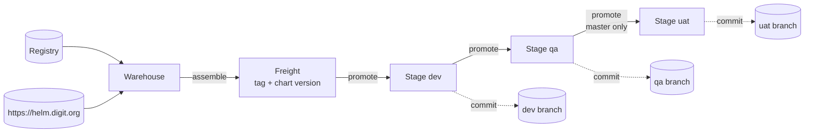

# Kargo Guide

<sub>**Deployment Guide** · Part 4 of 11 · [Contents](README.md) · Next: [Argo CD Guide](05-argocd-guide.md)</sub>

How Kargo discovers builds, bundles them into releases and promotes them through environments, and how to onboard an application or a project. Applies to the **Kargo + Argo CD** model.

## Contents

- [Concepts in one minute](#concepts-in-one-minute)
- [Warehouses: discovering builds](#warehouses-discovering-builds)
- [Freight: the release you promote](#freight-the-release-you-promote)
- [Stages and promotion](#stages-and-promotion)
- [Onboard an application](#onboard-an-application)
- [Onboard a project](#onboard-a-project)
- [Field reference](#field-reference)

## Concepts in one minute

A release of a service is **two artifacts that belong together**:

| Artifact | Published to | Example |
|---|---|---|
| Container image (and optional migration image `<service>-db`) | Container registry | `docker.io/<registry-org>/<service>:master-1a2b3c4` |
| Packaged Helm chart | `https://helm.digit.org` | chart `<service>`, version `1.4.0` |

Kargo pins one image tag and one chart version together as **Freight** and moves it from environment to environment. A promotion **writes those versions into the environment's env file and pushes a commit**; Argo CD then deploys them.



| Kargo object | One per | Purpose |
|---|---|---|
| Project | module | Groups the module's pipelines; a namespace on the Kargo cluster |
| Warehouse | service | Watches the image and chart; produces Freight |
| Freight | release | Immutable bundle: one image tag + one chart version |
| Stage | service × environment | Holds the Freight an environment runs; runs the promotion steps |

**Kargo objects are never created by hand.** They are rendered from a project config file (pipeline chart, [templates/kargo/project-config.yaml](templates/kargo/project-config.yaml)) or, without the chart, from the raw manifests in [templates/kargo/manifests](templates/kargo/manifests). Both are applied by Argo CD from git.

## Warehouses: discovering builds

Each service gets a Warehouse with up to two subscriptions:

| Subscription | Added when | Discovers |
|---|---|---|
| `image` | always, unless `image: false` | Tags of `<registry>/<service>` matching the tag filter |
| `chart` | `chart:` is set | Versions of the chart in `https://helm.digit.org` |

### Tag filters

The registry usually holds mainline builds, branch builds and per-architecture children. Only tags matching the filter can become Freight.

| Setting | Level | Effect |
|---|---|---|
| `allowTags` | project default, or per service (replaces it) | The main filter |
| `extraAllowTags` | service | Appended with `\|` for one service's extra build families |

Anchor patterns on the trailing commit hash so `-amd64` / `-arm64` children never match:

```yaml
allowTags: '^(master|release)-.*[0-9a-f]{7,}$'
services:
  - name: <service>
    extraAllowTags: '^<branch-prefix>-.*[0-9a-f]{7,}$'   # this service only
```

A Warehouse that finds nothing is **Not Ready: "No references discovered"**: the filter matches no existing tag.

### Chart-only services

Charts that ship no image of their own (a module's configuration chart, or a third-party chart whose image is fixed by the chart) set `image: false`. Their Freight carries only a chart version.

### Discovery settings

| Setting | Recommended | Why |
|---|---|---|
| `freightCreationPolicy` | `Manual` | Freight is assembled deliberately |
| `interval` | `5m0s` | Re-scan frequency |
| `cacheByTag` | `true` | Cheap repeat scans |
| `discoveryLimit` | `20` | How many candidates are offered, newest first |
| `imageSelectionStrategy` | `NewestBuild` | Orders tags by image build date |

## Freight: the release you promote

With `freightCreationPolicy: Manual`, a release engineer **assembles Freight in the Kargo UI**: open the Warehouse, choose one image tag and one chart version, create.

- **Choose the tag deliberately.** Build dates can be identical across tags, which makes "newest" ordering meaningless.
- **The app image and migration image share the tag.** For services with `dbMigration: true`, both `<service>` and `<service>-db` must exist for that tag.
- **The chart version must remain published** while any environment uses it.
- **Freight is per service.** Releasing five services takes five Freight.

## Stages and promotion

```yaml
stages:
  - name: dev
    branch: <dev-branch>
    envFile: <environments-dir>/<module>-dev.yaml
    autoPromotion: false
  - name: qa
    from: dev            # only Freight that has been in dev
    branch: <qa-branch>
    envFile: <environments-dir>/<module>-qa.yaml
    autoPromotion: false
  - name: uat
    from: qa             # only Freight that has been in qa
    branch: <uat-branch>
    envFile: <environments-dir>/<module>-uat.yaml
    autoPromotion: false
```

- **Linear:** dev ← Warehouse, qa ← dev, uat ← qa.
- **Manual:** every promotion is a person's action.
- **Mainline only in uat:** `masterOnlyStages` (default `[uat]`) rejects any non-`master-*` image, loudly, before anything is written. There are no per-service exemptions.

### What a promotion does

1. Clones the stage's branch.
2. Writes the Freight's versions into the stage's env file (merge).
3. Commits `kargo: promote <service> to <env>` and pushes.

Argo CD on that environment's cluster picks the commit up within about a minute.

### Keys written

| Key | Value | When |
|---|---|---|
| `<service>.chart-version` | Chart version from the Freight | `chart:` set |
| `<service>.image.tag` | Image tag | Service has an image |
| `<service>.initContainers.dbMigration.image.tag` | Same tag | `dbMigration: true` |

The section name is `valuesKey`, defaulting to the service name. Use `envFileWrite: merge`: missing keys are created, and every other value is left untouched. The older `update` mode requires every key to be seeded beforehand.

These keys are **owned by Kargo**; all other env-file content is written by pull request.

## Onboard an application

**Prerequisites**

- [ ] The chart is published in `https://helm.digit.org`.
- [ ] At least one image tag matching the filter exists (plus `<service>-db` if the service migrates a database).
- [ ] The service's values (replicas, ingress, overrides) are known.

**Steps**

1. **Add the service** to `config/projects/<project>.yaml`:

   ```yaml
   - name: <service>
     chart: <service>
     dbMigration: true                 # only with a <service>-db image
     freightCreationPolicy: Manual
     imageSelectionStrategy: NewestBuild
     cacheByTag: true
     discoveryLimit: 20
     interval: 5m0s
     # deploy: { layout: root, namespace: <other-namespace> }   # only if not the project default
   ```

2. **Add its values** to each env file, in a section named after the chart. Do not add `chart-version` or image tags.
3. **Raise one pull request.** After merge the Warehouse and Stages appear (Application `kargo-<project>`).
4. **Check the Warehouse is Ready** and lists tags and chart versions.
5. **Assemble Freight and promote to dev.**
6. **Check Argo CD:** with Kargo-managed Applications, `<app-prefix><service>` appears about a minute after the promotion; it should reach Synced and Healthy.

Promote to qa and uat later, in order.

## Onboard a project

1. **Project config** from [templates/kargo/project-config.yaml](templates/kargo/project-config.yaml). Set:
   - `project`, `registry`, `chartRepo`, `allowTags`, `envFileWrite: merge`;
   - a unique `argocdAppPrefix`;
   - `stages` with branches and env files;
   - `teams` for access ([07 Access Control](07-access-control.md));
   - optionally `argocd` (Kargo-managed Applications, [05 Argo CD Guide](05-argocd-guide.md)).
2. **Pipelines ApplicationSet:** add `- name: <project>` (and its branch).
3. **Env files** per stage ([03 Repository Layout and Conventions](03-repository-layout-and-conventions.md)).
4. **Credentials** in the project namespace (image and git, see [02](02-prerequisites-and-installation.md)).
5. **Argo CD side:** AppProject, config Application, Applications ([05 Argo CD Guide](05-argocd-guide.md)).
6. **Merge, then verify:** `kargo-<project>` is Synced, and each Warehouse is Ready (or waiting only for a first matching build).

## Field reference

### Project (`kargo:`)

| Field | Meaning |
|---|---|
| `project` | Project name (= namespace on the Kargo cluster) |
| `registry` | Image registry prefix |
| `chartRepo` | Default Helm repository (`https://helm.digit.org`) |
| `chartVersionKey` | Env-file key for the chart version (default `chart-version`) |
| `allowTags` | Default tag filter |
| `masterOnlyStages` | Stages accepting only `master-*` images (default `[uat]`) |
| `envFileWrite` | `merge` (recommended) or `update` |
| `argocdAppPrefix` | Prefix of Argo CD Application names |
| `git.repoURL` | Repository holding the env files |
| `argocd` | Optional: `project`, `namespace`, `namespaces`, `layout` for Kargo-managed Applications |
| `stages`, `teams`, `services` | See below and [07](07-access-control.md) |

### Service (`services[]`)

| Field | Meaning |
|---|---|
| `name` | Warehouse name, Stage prefix, default env-file section |
| `chart`, `chartRepo`, `chartSemver` | Chart name; per-service repository and version constraint |
| `image` | `false` for chart-only services |
| `repo` | Image repository name if different from `name` |
| `valuesKey` | Env-file section to write (default `name`) |
| `dbMigration` | Also write the tag for the migration image |
| `allowTags`, `extraAllowTags` | Replace / extend the tag filter |
| `freightCreationPolicy`, `interval`, `cacheByTag`, `discoveryLimit`, `imageSelectionStrategy` | Discovery behaviour |
| `deploy` | Optional Argo CD placement: `layout`, `namespace`, `app`, `releaseName` |

### Stage (`stages[]`)

| Field | Meaning |
|---|---|
| `name` | Environment; Stages are `<service>-<name>` |
| `from` | Upstream stage (omit on the first) |
| `direct` | With `from`, also accept Freight straight from the Warehouse |
| `branch`, `envFile` | Where the promotion writes |
| `autoPromotion` | Keep `false` |
| `argocdUpdate`, `argocdNamespace` | Ask a same-cluster Argo CD to sync immediately after the push |
| `color` | UI colour |
| `verifyKubeconfigSecret` | Enables post-promotion verification for the stage |

---

<sub>← Previous: [Repository Layout and Conventions](03-repository-layout-and-conventions.md) &nbsp;|&nbsp; [Contents](README.md) &nbsp;|&nbsp; Next: [Argo CD Guide](05-argocd-guide.md) →</sub>
