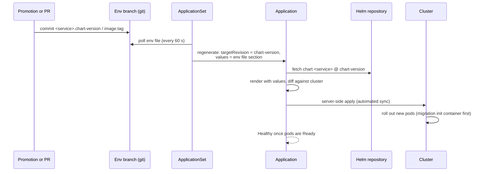

# 05 Argo CD Guide

How Argo CD deploys packaged charts from the environment branches, how a chart version in an env file becomes a running Deployment, and how to onboard applications and modules. Applies to **both** adoption models.

## Contents

- [The model](#the-model)
- [Bootstrap and AppProjects](#bootstrap-and-appprojects)
- [From env file to running Deployment](#from-env-file-to-running-deployment)
- [Generating Applications](#generating-applications)
- [Values layouts](#values-layouts)
- [Onboard an application](#onboard-an-application)
- [Onboard a module](#onboard-a-module)
- [How deployments are managed](#how-deployments-are-managed)

## The model

- **Git is the single source of truth.** Every object Argo CD manages is rendered from the environment branch.
- **Packaged charts.** Applications install `chart <service>` from `https://helm.digit.org` at the **exact version** pinned in the env file.
- **Env file per module.** Values and pinned versions for every service of the module ([03](03-repository-layout-and-conventions.md)).
- **Automated sync with self-heal.** The cluster is continuously reconciled to git.

## Bootstrap and AppProjects

### Bootstrap

Each cluster runs one Application applied by hand ([templates/argocd/bootstrap-application.yaml](templates/argocd/bootstrap-application.yaml)). It syncs `<argocd-dir>/<env>/` recursively, so **adding a manifest file creates the object**.

| Setting | Consequence |
|---|---|
| `selfHeal: true` | Edits made on the cluster to these objects are reverted |
| `prune: false` | **Deleting a file does not delete the object**; retired objects are removed by hand ([08](08-operations-runbook.md)) |

### AppProject: the security boundary

One per module ([templates/argocd/appproject.yaml](templates/argocd/appproject.yaml)):

| Field | Rule |
|---|---|
| `sourceRepos` | Every repository its Applications use: the git repo **and** `https://helm.digit.org` |
| `destinations` | Exactly the module's namespaces. Anything rendered elsewhere fails the sync. |
| `clusterResourceWhitelist` | Empty, unless a chart cannot work without a specific cluster-scoped kind |

## From env file to running Deployment



1. **A commit changes** `<service>.chart-version` and/or `<service>.image.tag`: a Kargo promotion, or a pull request in the Argo CD only model.
2. **The ApplicationSet re-reads the env file** (git generator, `requeueAfterSeconds: 60`).
3. **The Application is regenerated:**
   - `source.chart: <service>`;
   - `source.targetRevision: <chart-version>`;
   - `helm.valuesObject`: the env-file values for the service, including `image.tag`.
4. **Argo CD renders** the chart at that version with those values, and computes the difference from the cluster.
5. **Automated sync applies** the difference with server-side apply. The Deployment's pod template changes, so Kubernetes rolls out new pods.
6. **Health** is Progressing until the new pods are Ready, then Healthy.

Expect the sync to start about one minute after the commit.

**Two details decide what actually runs:**

- **Chart versions are exact.** A version removed from the Helm repository can no longer be rendered (`ComparisonError`), and Argo CD keeps the last applied state.
- **Image-tag mode.** Some library charts use the chart's `appVersion` as the image tag unless told otherwise. Where Kargo promotes image tags, set the chart's switch in the env file, for example:

  ```yaml
  global:
    mode: dev     # honour <service>.image.tag
  ```

## Generating Applications

### Kargo-managed Applications (Kargo + Argo CD)

Three shared ApplicationSets ([templates/argocd/applicationset-kargo-managed-*.yaml](templates/argocd)) read every Kargo project config that has an `argocd:` block, then that project's env file. They create one Application per service **once its `chart-version` exists in the env file**, which is after its first promotion. **Adding a service is one entry in the Kargo project config; no ApplicationSet changes.**

```yaml
kargo:
  argocdAppPrefix: <app-prefix>
  argocd:
    project: <module>-project          # AppProject
    namespace: <namespace>             # default namespace
    namespaces: [<namespace>]          # must equal the AppProject's destinations
    layout: common                     # default layout
  services:
    - name: <service>                  # → Application <app-prefix><service>
      chart: <service>
    - name: <gateway-service>
      chart: <gateway-chart>
      deploy: { layout: root, namespace: <other-namespace> }
```

| Application field | Taken from |
|---|---|
| Name | `deploy.app`, else `argocdAppPrefix` + service name |
| AppProject | `argocd.project` |
| Namespace | `deploy.namespace`, else `argocd.namespace` |
| Chart and repository | `chart`, `chartRepo` |
| Chart version | `<service>.chart-version` in the stage's env file |
| Release name | `deploy.releaseName`, else the service name |

The pipeline chart refuses to render a project whose service names an unknown layout, or a namespace outside `argocd.namespaces`.

### Hand-listed ApplicationSet (Argo CD only)

[templates/argocd/applicationset-argocd-only.yaml](templates/argocd/applicationset-argocd-only.yaml) lists the services and reads the same env file. **Engineers set `chart-version` and `image.tag` by pull request.**

With `missingkey=error`, a listed service whose env file has no `chart-version` stops generation for the **whole** ApplicationSet. Add the element only when its version is in the env file, or guard the git generator with a selector:

```yaml
selector:
  matchExpressions:
    - key: <service>.chart-version
      operator: Exists
```

| | Kargo-managed | Hand-listed |
|---|---|---|
| Who writes versions | Kargo promotions | Engineers, by pull request |
| Add a service | One entry in the Kargo config | One list element + versions in the env file |
| ApplicationSet edits per service | None | One |

## Values layouts

Charts expect values in different shapes. A **layout** is how an Application hands the env file's values to a chart. Services choose a layout; each layout is one shared ApplicationSet.

| Layout | Values given to the chart | Typical charts |
|---|---|---|
| `common` | `{ global: <global>, <service>: <service section> }` | Service charts built on a shared library chart reading `.Values.global` and `.Values.<service>` |
| `root` | The service section as **root** values, minus `chart-version`; CRDs skipped | Third-party-style charts (gateways, secret stores) |
| `configs` | The whole env file plus its `-secrets.yaml` twin, as value files from git | The module's configuration chart (ConfigMaps, Secrets) |

- **Layout and namespace are independent.** Two services in one layout can deploy to different namespaces.
- **New layouts are rare.** Add one only for a chart none of the three can serve; it then serves every project.

## Onboard an application

### Kargo + Argo CD

1. Publish the chart; confirm matching image tags exist.
2. Add the service to the Kargo project config ([04](04-kargo-guide.md)); add `deploy:` only if it differs from the project defaults.
3. Add its values to the env files, in a section named after the chart.
4. **New namespace?** Add it to the AppProject `destinations` **and** `argocd.namespaces` in the same pull request.
5. Merge, assemble Freight, promote to dev. Check that `<app-prefix><service>` reaches Synced and Healthy.

### Argo CD only

1. Publish the chart.
2. In the env file, add the service section with `chart-version`, `image.tag` (and the migration tag) and its values.
3. Add the list element to the module's ApplicationSet, or rely on the selector.
4. Namespace changes as above.
5. Merge; check Synced and Healthy. Later releases are pull requests that change the version keys, one environment branch at a time.

### Before raising either pull request

Follow the checks in [09 SOP and Guardrails](09-sop-and-guardrails.md#before-raising-a-pull-request): render the chart with the env file, look for duplicate env var names, confirm every referenced ConfigMap/Secret key exists, confirm the Ingress path is free.

## Onboard a module

1. **Env files** per environment (`global`, `cluster-configs`, service sections).
2. **Secrets:** a `.sops.yaml` rule, then the encrypted `-secrets.yaml` ([06](06-configuration-and-secrets.md)).
3. **AppProject** with the git and Helm repositories and the module's namespaces.
4. **Applications:**
   - Kargo + Argo CD: the `argocd:` block in the Kargo project config;
   - Argo CD only: the module ApplicationSet and a config Application ([templates/argocd/config-application.yaml](templates/argocd/config-application.yaml)).
5. **Namespace ownership:** exactly one Application owns each Namespace object (the module's config Application, or a cluster-wide one).
6. **Order:** the AppProject must exist before an ApplicationSet that uses it is first reconciled. If an ApplicationSet reports that its project does not exist, refresh it once the AppProject is there ([10](10-troubleshooting.md)).

## How deployments are managed

Generated Applications use this policy:

```yaml
syncPolicy:
  automated:
    prune: false        # removals are deliberate
    selfHeal: true      # drift is reverted
  syncOptions:
    - ApplyOutOfSyncOnly=true
    - ServerSideApply=true
  retry:
    limit: 10
    backoff: { duration: 5s, factor: 2, maxDuration: 3m0s }
ignoreDifferences:
  - group: apps
    kind: Deployment
    jsonPointers: [/spec/replicas]
```

| Situation | Behaviour |
|---|---|
| Someone edits a managed object on the cluster | Reverted within seconds; change git instead |
| A resource disappears from the render | Stays on the cluster until removed by hand |
| Two ApplicationSets generate the same Application name | The second fails with "already owned by another ApplicationSet"; hand ownership over as in [08](08-operations-runbook.md) |
| An ApplicationSet is deleted | Its Applications are deleted too, unless deleted with `--cascade=orphan` |
| A release must be undone | Promote the previous Freight (Kargo), or revert the commit |
