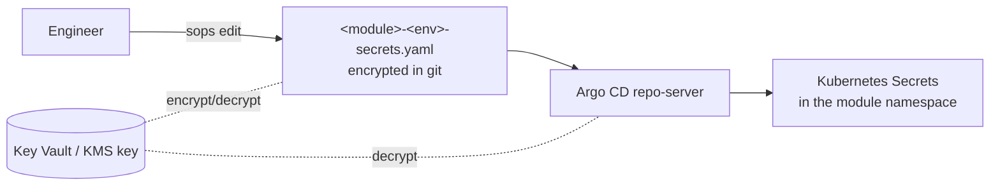

# Configuration and Secrets

<sub>**Deployment Guide** · Part 6 of 11 · [Contents](README.md) · Next: [Access Control](07-access-control.md)</sub>

## Where each value belongs

| Value | Location |
|---|---|
| Shared by every service in a module (database host and URL, message broker, domain, time zone) | `cluster-configs.configmaps.<shared-config>.data` in the module env file |
| Addresses of the services a module calls | `cluster-configs.configmaps.<service-host-config>.data` |
| A password, key, token or certificate | The module's `-secrets.yaml`, encrypted with SOPS |
| One service's setting (replicas, ingress, an environment override) | That service's section in the env file |
| Chart version and image tag | Written by Kargo, or by pull request in the Argo CD only model |
| A value used by every module on the cluster | The cluster-wide configuration, owned by the platform team |

DIGIT service charts read two shared ConfigMaps by name, `egov-config` (settings) and `egov-service-host` (service addresses), and Secrets such as `db`. The examples below use those names.

## The module config Application

Each module has **its own** config Application rendering its ConfigMaps and Secrets **into its own namespaces only** ([templates/argocd/config-application.yaml](templates/argocd/config-application.yaml)).

- With Kargo-managed Applications, the configuration chart is a Kargo service with `deploy.layout: configs`.
- Otherwise it is a standalone Application using the configuration chart, the module env file and its secrets file.

```yaml
cluster-configs:
  namespaces:
    create: false            # true only if THIS Application owns the Namespace object
    values: [<namespace>]
  configmaps:
    egov-config:
      namespace: [<namespace>]
      data:
        db-host: <db-host>
        db-url: jdbc:postgresql://<db-host>:5432/<db-name>
        kafka-brokers: <kafka-host>:9092
    egov-service-host:
      namespace: [<namespace>]
      data:
        <service>: http://<service>.<namespace>:8080/
  secrets:
    db:
      namespace: [<namespace>]
```

### Keeping a module's configuration inside its namespaces

A configuration chart usually carries cluster-wide defaults (cluster roles, a root ingress, Secrets for platform namespaces). In a module's own config Application, **switch those off** so nothing renders outside the module's namespaces:

```yaml
cluster-configs:
  cluster-roles:
    enabled: false
  root-ingress: null
  secrets:
    <default-secret-not-needed-here>: null   # removes a chart default
```

Verify by rendering the Application: every object must be in the module's namespaces, and no other Application may already own any of them.

**Never layer one module's env file onto another module's config Application.** A ConfigMap of the same name would replace the other module's.

### Multiple namespaces

To place the same ConfigMap in several namespaces, list them (`namespace: [<ns-a>, <ns-b>]`). Templates that loop over namespaces must emit **one YAML document per object** (`---` inside the loop). Otherwise only the last namespace receives the object.

## Secrets with SOPS

### How it works



- Values are encrypted **per value** in git; keys stay readable.
- `.sops.yaml` chooses the key for each file by path ([templates/environments/sops.yaml](templates/environments/sops.yaml)).
- Argo CD's repo-server decrypts at render time:
  - single-source Applications reference the file as `secrets://<path>`;
  - the multi-source `configs` layout reads it through its `$values` source.

### Create a secrets file

1. Add the `.sops.yaml` rule for `<module>-<env>-secrets.yaml` (first-match wins; place it above general rules).
2. Write the structure ([templates/environments/module-env-secrets.example.yaml](templates/environments/module-env-secrets.example.yaml)) to the real file name, with real values, on your machine only.
3. Encrypt in place:

   ```sh
   sops --encrypt --in-place <environments-dir>/<module>-<env>-secrets.yaml
   ```

4. Confirm that it is encrypted (`grep -c 'ENC\[' <file>` is greater than 0), then commit it.

### Edit a secrets file

```sh
sops <environments-dir>/<module>-<env>-secrets.yaml
```

Never use a plain editor: it breaks the file's integrity check, and the repo-server will refuse it.

### Rules

- Never commit decrypted values, and never paste them into pull requests, tickets or chat.
- Never copy one environment's cluster credentials (API endpoints, tokens) into another environment.
- Share credentials through a password manager or another secure channel.
- Rotate a secret at its source first, then update the encrypted file by pull request.

---

<sub>← Previous: [Argo CD Guide](05-argocd-guide.md) &nbsp;|&nbsp; [Contents](README.md) &nbsp;|&nbsp; Next: [Access Control](07-access-control.md) →</sub>
