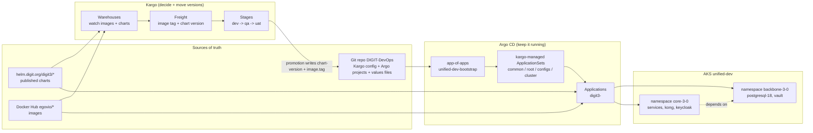
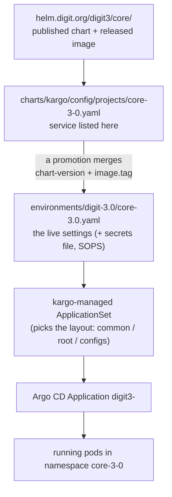
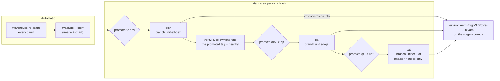
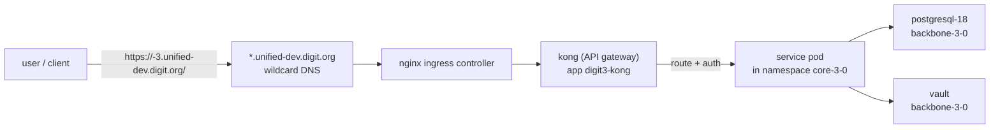
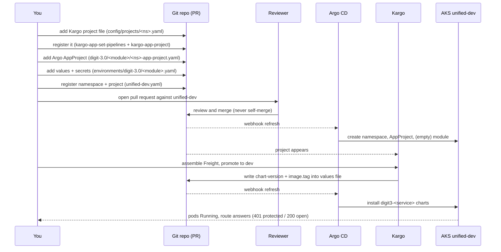
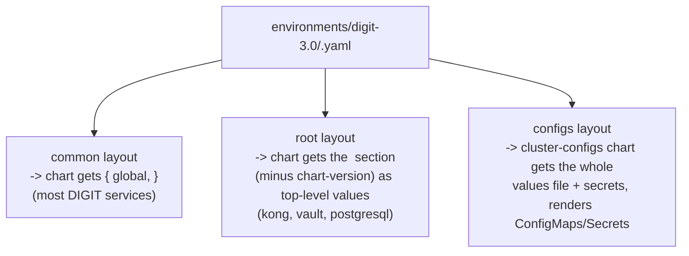

# DIGIT 3.0 architecture: how everything is wired

This page shows the moving parts and how they connect. The diagrams render on GitHub. Read
[README.md](README.md) for the plain-language model; this page is the picture behind it.

## 1. The whole system at a glance

Three sources of truth feed the cluster: this **git repository** (settings and structure), the
published **Helm repository** (the charts and their released images), and **Docker Hub** (the
images). **Argo CD** turns charts + settings into running pods. **Kargo** decides which versions
to use and writes them back into the repository.

Read it as: **Kargo writes versions into git; Argo CD reads git and makes the cluster match.**
The two never talk to each other directly - the git repository is the hand-off point.

## 2. From a file in the repo to a running pod

Every running service traces back through these layers. Each arrow is plain text you can open.

## 3. How versions are promoted (dev -> qa -> uat)

Discovery is automatic; every promotion is a person's decision. Promotion is linear - a stage can
only take what the stage before it already has.

Each stage writes to the **same** values file but on its **own branch** (`unified-dev`,
`unified-qa`, `unified-uat`), so the branch decides which versions are live where.

## 4. How a request reaches a service at runtime

Public traffic enters through one wildcard hostname and is routed by the API gateway to the right
service; services use the module's own database and vault.

A protected route returns **401** without a token (reachable, auth required); an open route
returns **200**. A **404** or **502** means the route or the service is not up.

## 5. What you create when you onboard a product

Onboarding is adding text in a few known places, opening a pull request, and letting the system
reconcile. Nothing is created directly on the cluster by hand.

## 6. The three value layouts (how a chart receives its settings)

A service's values section is handed to its chart in one of three shapes. The Kargo project file
picks the layout; the kargo-managed ApplicationSet applies it.

Use **common** for ordinary services, **root** for third-party-style charts that expect plain
values, and **configs** only for `cluster-configs`.

## Where to go next

- Add a product: [add-a-new-product.md](add-a-new-product.md)
- Add a service: [add-a-new-service.md](add-a-new-service.md)
- Operate and troubleshoot: [operate-argocd-and-kargo.md](operate-argocd-and-kargo.md)
- File-by-file reference: [structure.md](structure.md)
